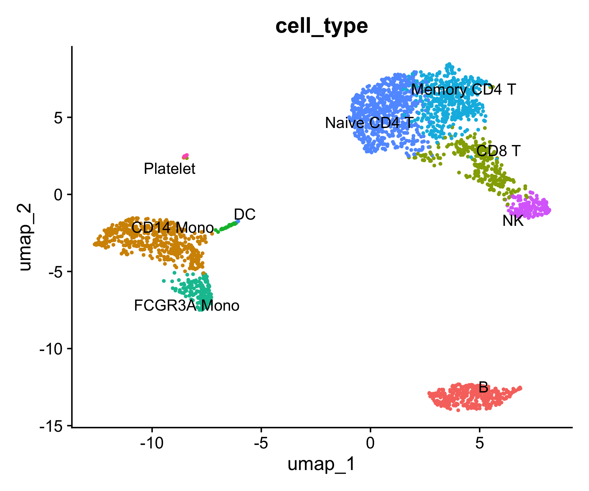
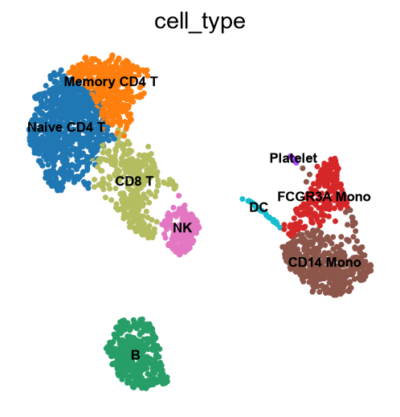

# singlecell

Side-by-side single-cell RNA-seq workflows in **Seurat (R)** and **Scanpy (Python)**, run on the 10x Genomics PBMC 3k dataset.

Both scripts apply the same QC thresholds and end with the same 9 annotated cell types, so they're a handy reference for moving between the two ecosystems.

## Contents

| File | What it does |
| --- | --- |
| `seurat_pbmc3k.R` | Seurat v5: QC, normalisation, PCA, UMAP, Louvain clustering, markers (presto), annotation, plots |
| `scanpy_pbmc3k.py` | Scanpy: the same workflow with Leiden clustering |
| `plots/` | Seurat figures |
| `plots_scanpy/` | Scanpy figures |

## Results

2,638 cells after QC, 9 clusters:

Naive CD4 T, Memory CD4 T, CD14 Mono, B, CD8 T, FCGR3A Mono, NK, DC, Platelet

| Seurat | Scanpy |
| --- | --- |
|  |  |

Cluster sizes differ slightly between the two (Louvain vs Leiden and different neighbour graphs), as expected.

## Setup (macOS, Apple Silicon)

**R**

```bash
brew install --cask r
```

```r
install.packages(c("Seurat", "harmony", "remotes", "BiocManager", "patchwork", "dplyr"), type = "binary")
BiocManager::install("glmGamPoi")
remotes::install_github("immunogenomics/presto")
```

**Python**

```bash
uv venv .venv-scanpy && source .venv-scanpy/bin/activate
uv pip install "scanpy[leiden]" harmonypy ipykernel
```

## Run

```bash
Rscript seurat_pbmc3k.R      # downloads PBMC 3k on first run
python scanpy_pbmc3k.py      # reuses the same download
```

Data: [10x Genomics PBMC 3k](https://cf.10xgenomics.com/samples/cell/pbmc3k/pbmc3k_filtered_gene_bc_matrices.tar.gz)

## Running the pipeline

The scripts above are standalone tutorials. `scpipe` is the pipeline being built from them
(design in [`docs/DESIGN.md`](docs/DESIGN.md)). Stages S0–S2 are available so far: ingest,
QC metrics with rules-based QC decisions, and core processing (normalise, variable genes, PCA,
optional Harmony, neighbours, Leiden, UMAP) on CPU or GPU. The exact behaviour of each stage is
in [`docs/stages-spec.md`](docs/stages-spec.md).

### Install

**R** 4.3 or newer:

```r
install.packages(c("Seurat", "SeuratObject", "hdf5r", "Matrix", "jsonlite", "digest", "yaml",
                   "leidenbase", "uwot"))
# optional: Harmony integration on the CPU path, faster object files
install.packages(c("harmony", "qs2"))
```

**Python** 3.12 or newer, from the repository root:

```bash
python -m venv .venv && source .venv/bin/activate
pip install -e "python[harmony,test]"
# on a machine with an NVIDIA GPU (CUDA 12), for the GPU path:
pip install -e "python[gpu]"
```

Without the editable install, set `PYTHONPATH=python` and run `python -m scpipe` instead of
`scpipe`.

### Check the setup

```bash
scpipe doctor --config config/examples/config.yaml
```

`doctor` lists the R and Python packages it found, which optional ones are missing, whether a
GPU is usable, and whether the run directory is writable.

### Configure

Copy the three files in [`config/examples/`](config/examples) next to your data and edit them:

| File | What goes in it |
|---|---|
| `config.yaml` | Project name, run directory, resource caps, doublet method, normalisation, device (`auto` / `cpu` / `gpu`), integration, PCs, neighbours, clustering resolution |
| `samples.csv` | One row per sample: `sample_id`, `path`, optional `format` (10x `.h5`, 10x mtx folder, `.h5ad`, Seurat `.rds`/`.qs2`, loom, csv/tsv; auto-detected when blank), and any metadata columns |
| `qc_policy.yaml` | Hard limits, adaptive MAD bounds, doublet handling, protected populations and review triggers |

Paths in `config.yaml` and `samples.csv` can be relative to the folder holding `config.yaml`.
Counts must be raw: S0 stops with a message if a sample looks normalised.

### Run

```bash
scpipe run --config config/examples/config.yaml --detach     # runs inside tmux (or nohup)
scpipe status --run-dir /scratch/$USER/scpipe/my_study        # stage states, timings, peak memory
scpipe resume --run-dir /scratch/$USER/scpipe/my_study        # continue after a disconnect or kill
```

`--detach` prints how to reattach. `--run-dir DIR` overrides `run_dir` from the config, and
`--until S1c` stops after a given stage. Running `scpipe run` again with the same config skips
every finished stage; after a config change, only the stages that use the changed settings (and
the stages after them) run again. For example, a new `clustering.resolution` reruns only S2.

### Run directory

```
<run_dir>/
  config/        copies of config.yaml, samples.csv, qc_policy.yaml; config.resolved.yaml; hashes.json
  state.json     per stage: status, start/end, wall time, peak memory, input fingerprint
  logs/          one log per stage (S0.log, S1a.log, S1b.log, S1c.log, S2.log)
  S0/            object.rds (all samples merged, raw counts), ingest_report.json
  S1/            qc_metrics.tsv.gz, qc_decisions.tsv.gz, qc_summary.json
  S2/            object.rds (filtered, normalised, PCA/UMAP, graphs, clusters), summary.json
```

The results to look at are `S1/qc_decisions.tsv.gz` and `S1/qc_summary.json` (which cells were
kept, excluded or sent to review, and why), and `S2/object.rds`, a Seurat object you can load
with `readRDS()`, with clusters in `seurat_clusters`. `S2/summary.json` records which device and
memory plan were used and why.

### On a shared login node

The example config keeps to 8 threads, 64 GB of RAM and 20 GB of GPU memory, and runs under
`nice 10`. Read [`docs/DESIGN.md` section 2.1](docs/DESIGN.md#21-running-on-a-shared-login-node)
before running on a login node such as Iridis X, and confirm with your HPC team that it is
allowed. Use `--detach` so the run survives a dropped SSH session, and put `run_dir` on scratch.

### Tests

See [`tests/README.md`](tests/README.md). There is no hosted CI; the tests run locally or on the HPC.
