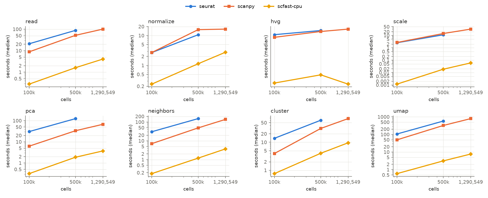
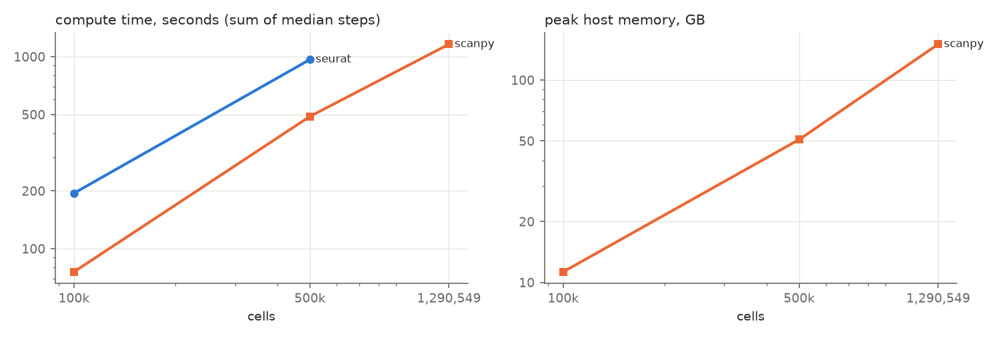

# Benchmark report: `brain_cpu16`

Node `modal` · unknown · 32 logical CPUs · GPU: none · commit `unknown`

Seurat 5.6.0 Leiden backend: leidenbase.

## End to end

Compute = normalise → UMAP (median of measured repeats, summed). Read and CPU⇄GPU transfers are shown separately. Speed-up and memory ratio are against Seurat at the same size; higher is better.

| Cells | Engine | Compute s | Read s | Transfer s | Peak RSS GB | Peak GPU GB | Speed-up | Memory ratio | PC sim | kNN overlap | ARI | Verdict |
|---:|---|---:|---:|---:|---:|---:|---:|---:|---:|---:|---:|---|
| 100,000 | seurat | 194.60 | 21.01 | 0.00 | – | – | 1.00× | –× | – | – | – | baseline |
| 100,000 | scanpy | 75.79 | 8.85 | 0.00 | 11.28 | – | 2.57× | –× | 1.000 | 0.995 | 0.585 | fails parity |
| 100,000 | scfast-cpu | 2.40 | 0.27 | 0.00 | 3.24 | – | 81.20× | –× | 1.000 | 0.963 | 0.693 | fails parity |
| 500,000 | seurat | 966.82 | 88.44 | 0.00 | – | – | 1.00× | –× | – | – | – | baseline |
| 500,000 | scanpy | 488.66 | 51.99 | 0.00 | 50.85 | – | 1.98× | –× | 1.000 | 0.993 | 0.602 | fails parity |
| 500,000 | scfast-cpu | 8.99 | 1.24 | 0.00 | 13.99 | – | 107.49× | –× | 1.000 | 0.959 | 0.565 | fails parity |
| 1,290,549 | scanpy | 1161.61 | 101.01 | 0.00 | 150.33 | – | –× | –× | – | – | – | no parity data |
| 1,290,549 | scfast-cpu | 23.70 | 7.11 | 0.00 | 45.88 | – | –× | –× | – | – | – | no parity data |

Parity thresholds: PC similarity ≥ 0.99, kNN overlap ≥ 0.9, ARI ≥ 0.9. Adoption: parity passes and, at ≥ 100,000 cells, ≥ 1.5× faster or ≥ 2.0× less peak memory. Scanpy and rapids run their own pipelines (different HVG, graph and Leiden implementations), so their parity is informative only; the rule is meant for scfast.

## Per step

Median wall time in seconds (min–max over measured repeats); peak RSS within the step when the platform supports per-step peaks.

| Cells | Engine | Step | Median s | Min–max s | Repeats | Peak RSS GB | RSS scope |
|---:|---|---|---:|---:|---:|---:|---|
| 100,000 | seurat | read | 21.008 | 20.756–21.769 | 3 | – | process |
| 100,000 | seurat | normalize | 2.691 | 2.689–2.714 | 3 | – | process |
| 100,000 | seurat | hvg | 7.965 | 7.940–8.178 | 3 | – | process |
| 100,000 | seurat | scale | 2.563 | 2.408–2.720 | 3 | – | process |
| 100,000 | seurat | pca | 30.545 | 30.392–30.558 | 3 | – | process |
| 100,000 | seurat | neighbors | 30.505 | 30.393–30.551 | 3 | – | process |
| 100,000 | seurat | cluster | 13.846 | 12.770–15.195 | 3 | – | process |
| 100,000 | seurat | umap | 106.482 | 105.588–108.299 | 3 | – | process |
| 100,000 | scanpy | read | 8.846 | 8.826–8.992 | 3 | 11.23 | process |
| 100,000 | scanpy | normalize | 2.701 | 2.700–2.765 | 3 | 11.23 | process |
| 100,000 | scanpy | hvg | 3.664 | 3.656–3.667 | 3 | 11.23 | process |
| 100,000 | scanpy | scale | 2.690 | 2.660–2.764 | 3 | 11.23 | process |
| 100,000 | scanpy | pca | 6.239 | 5.651–8.197 | 3 | 11.28 | process |
| 100,000 | scanpy | neighbors | 7.059 | 6.994–7.146 | 3 | 11.28 | process |
| 100,000 | scanpy | cluster | 3.963 | 3.958–4.233 | 3 | 11.28 | process |
| 100,000 | scanpy | umap | 49.472 | 49.237–52.280 | 3 | 11.28 | process |
| 100,000 | scfast-cpu | read | 0.270 | 0.270–0.270 | 2 | 3.14 | process |
| 100,000 | scfast-cpu | normalize | 0.201 | 0.198–0.204 | 2 | 3.24 | process |
| 100,000 | scfast-cpu | hvg | 0.000 | 0.000–0.000 | 2 | 3.24 | process |
| 100,000 | scfast-cpu | scale | 0.013 | 0.007–0.019 | 2 | 3.24 | process |
| 100,000 | scfast-cpu | pca | 0.328 | 0.327–0.329 | 2 | 3.24 | process |
| 100,000 | scfast-cpu | neighbors | 0.166 | 0.162–0.170 | 2 | 3.24 | process |
| 100,000 | scfast-cpu | cluster | 1.065 | 1.039–1.091 | 2 | 3.24 | process |
| 100,000 | scfast-cpu | umap | 0.624 | 0.620–0.628 | 2 | 3.24 | process |
| 500,000 | seurat | read | 88.443 | 88.443–88.443 | 1 | – | process |
| 500,000 | seurat | normalize | 10.623 | 10.623–10.623 | 1 | – | process |
| 500,000 | seurat | hvg | 26.818 | 26.818–26.818 | 1 | – | process |
| 500,000 | seurat | scale | 11.259 | 11.259–11.259 | 1 | – | process |
| 500,000 | seurat | pca | 125.205 | 125.205–125.205 | 1 | – | process |
| 500,000 | seurat | neighbors | 152.600 | 152.600–152.600 | 1 | – | process |
| 500,000 | seurat | cluster | 61.315 | 61.315–61.315 | 1 | – | process |
| 500,000 | seurat | umap | 578.999 | 578.999–578.999 | 1 | – | process |
| 500,000 | scanpy | read | 51.989 | 51.989–51.989 | 1 | 33.92 | process |
| 500,000 | scanpy | normalize | 15.771 | 15.771–15.771 | 1 | 34.57 | process |
| 500,000 | scanpy | hvg | 20.210 | 20.210–20.210 | 1 | 34.57 | process |
| 500,000 | scanpy | scale | 14.324 | 14.324–14.324 | 1 | 34.57 | process |
| 500,000 | scanpy | pca | 33.517 | 33.517–33.517 | 1 | 50.85 | process |
| 500,000 | scanpy | neighbors | 48.831 | 48.831–48.831 | 1 | 50.85 | process |
| 500,000 | scanpy | cluster | 31.164 | 31.164–31.164 | 1 | 50.85 | process |
| 500,000 | scanpy | umap | 324.843 | 324.843–324.843 | 1 | 50.85 | process |
| 500,000 | scfast-cpu | read | 1.245 | 1.224–1.265 | 2 | 13.89 | process |
| 500,000 | scfast-cpu | normalize | 0.818 | 0.815–0.820 | 2 | 13.99 | process |
| 500,000 | scfast-cpu | hvg | 0.000 | 0.000–0.000 | 2 | 13.99 | process |
| 500,000 | scfast-cpu | scale | 0.014 | 0.013–0.014 | 2 | 13.99 | process |
| 500,000 | scfast-cpu | pca | 1.143 | 1.129–1.158 | 2 | 13.99 | process |
| 500,000 | scfast-cpu | neighbors | 0.938 | 0.919–0.957 | 2 | 13.99 | process |
| 500,000 | scfast-cpu | cluster | 3.593 | 3.382–3.803 | 2 | 13.99 | process |
| 500,000 | scfast-cpu | umap | 2.489 | 2.428–2.550 | 2 | 13.99 | process |
| 1,290,549 | scanpy | read | 101.011 | 101.011–101.011 | 1 | 97.87 | process |
| 1,290,549 | scanpy | normalize | 16.426 | 16.426–16.426 | 1 | 118.78 | process |
| 1,290,549 | scanpy | hvg | 40.644 | 40.644–40.644 | 1 | 129.24 | process |
| 1,290,549 | scanpy | scale | 32.341 | 32.341–32.341 | 1 | 129.24 | process |
| 1,290,549 | scanpy | pca | 67.326 | 67.326–67.326 | 1 | 150.33 | process |
| 1,290,549 | scanpy | neighbors | 138.586 | 138.586–138.586 | 1 | 150.33 | process |
| 1,290,549 | scanpy | cluster | 69.998 | 69.998–69.998 | 1 | 150.33 | process |
| 1,290,549 | scanpy | umap | 796.287 | 796.287–796.287 | 1 | 150.33 | process |
| 1,290,549 | scfast-cpu | read | 7.109 | 7.077–7.141 | 2 | 45.78 | process |
| 1,290,549 | scfast-cpu | normalize | 2.159 | 2.138–2.179 | 2 | 45.88 | process |
| 1,290,549 | scfast-cpu | hvg | 0.000 | 0.000–0.000 | 2 | 45.88 | process |
| 1,290,549 | scfast-cpu | scale | 0.028 | 0.028–0.028 | 2 | 45.88 | process |
| 1,290,549 | scfast-cpu | pca | 2.556 | 2.545–2.568 | 2 | 45.88 | process |
| 1,290,549 | scfast-cpu | neighbors | 3.110 | 3.101–3.119 | 2 | 45.88 | process |
| 1,290,549 | scfast-cpu | cluster | 9.245 | 9.025–9.466 | 2 | 45.88 | process |
| 1,290,549 | scfast-cpu | umap | 6.599 | 6.340–6.857 | 2 | 45.88 | process |

## Start-up (cold)

| Engine | Cells | Start-up s |
|---|---:|---:|
| scfast-cpu | 1,290,549 | 0.00 |
| scfast-cpu | 500,000 | 0.00 |
| scfast-cpu | 100,000 | 0.00 |
| scanpy | 1,290,549 | 4.47 |
| seurat | 500,000 | 4.39 |
| scanpy | 500,000 | 5.03 |
| seurat | 100,000 | 6.00 |
| scanpy | 100,000 | 5.01 |

## Scaling

Plotted values are in `summary_steps.csv` and `summary_totals.csv`.
