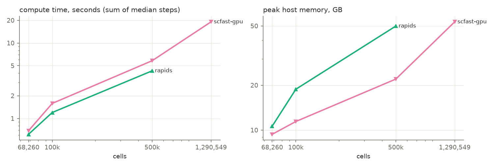

# Benchmark report: `gpu_h100_real`

Node `modal` · unknown · 32 logical CPUs · GPU: NVIDIA H100 80GB HBM3 · commit `unknown`

## End to end

Compute = normalise → UMAP (median of measured repeats, summed). Read and CPU⇄GPU transfers are shown separately. Speed-up and memory ratio are against Seurat at the same size; higher is better.

| Cells | Engine | Compute s | Read s | Transfer s | Peak RSS GB | Peak GPU GB | Speed-up | Memory ratio | PC sim | kNN overlap | ARI | Verdict |
|---:|---|---:|---:|---:|---:|---:|---:|---:|---:|---:|---:|---|
| 68,260 | rapids | 0.62 | 2.00 | 0.22 | 10.62 | 3.57 | –× | –× | 1.000 | 0.974 | 0.535 | fails parity |
| 68,260 | scfast-gpu | 0.69 | 0.08 | 0.00 | 9.36 | 2.23 | –× | –× | 1.000 | 0.994 | 0.727 | fails parity |
| 100,000 | rapids | 1.20 | 10.27 | 0.60 | 18.80 | 7.60 | –× | –× | 1.000 | 0.995 | 0.588 | fails parity |
| 100,000 | scfast-gpu | 1.58 | 0.28 | 0.00 | 11.42 | 2.70 | –× | –× | 1.000 | 0.996 | 0.548 | fails parity |
| 500,000 | rapids | 4.28 | 57.74 | 2.80 | 49.87 | 33.55 | –× | –× | 1.000 | 0.992 | 0.503 | fails parity |
| 500,000 | scfast-gpu | 5.83 | 1.38 | 0.00 | 21.99 | 9.00 | –× | –× | 1.000 | 0.994 | 0.476 | fails parity |
| 1,290,549 | scfast-gpu | 19.07 | 13.26 | 0.00 | 53.23 | 20.74 | –× | –× | – | – | – | no parity data |

Parity thresholds: PC similarity ≥ 0.99, kNN overlap ≥ 0.9, ARI ≥ 0.9. Adoption: parity passes and, at ≥ 100,000 cells, ≥ 1.5× faster or ≥ 2.0× less peak memory. Scanpy and rapids run their own pipelines (different HVG, graph and Leiden implementations), so their parity is informative only; the rule is meant for scfast.

## Agreement with known cell types

| Cells | Engine | ARI vs truth | Reference ARI vs truth |
|---:|---|---:|---:|
| 100,000 | rapids | – | – |
| 100,000 | scanpy | – | – |
| 100,000 | scfast-cpu | – | – |
| 100,000 | scfast-gpu | – | – |
| 500,000 | rapids | – | – |
| 500,000 | scanpy | – | – |
| 500,000 | scfast-cpu | – | – |
| 500,000 | scfast-gpu | – | – |
| 68,260 | rapids | 0.287 | 0.283 |
| 68,260 | scanpy | 0.258 | 0.283 |
| 68,260 | scfast-cpu | 0.270 | 0.283 |
| 68,260 | scfast-gpu | 0.265 | 0.283 |

## Per step

Median wall time in seconds (min–max over measured repeats); peak RSS within the step when the platform supports per-step peaks.

| Cells | Engine | Step | Median s | Min–max s | Repeats | Peak RSS GB | RSS scope |
|---:|---|---|---:|---:|---:|---:|---|
| 68,260 | rapids | read | 1.998 | 1.988–2.007 | 2 | 10.62 | process |
| 68,260 | rapids | to_gpu | 0.036 | 0.034–0.037 | 2 | 10.62 | process |
| 68,260 | rapids | normalize | 0.004 | 0.001–0.006 | 2 | 10.62 | process |
| 68,260 | rapids | hvg | 0.026 | 0.024–0.027 | 2 | 10.62 | process |
| 68,260 | rapids | scale | 0.022 | 0.021–0.022 | 2 | 10.62 | process |
| 68,260 | rapids | pca | 0.057 | 0.053–0.062 | 2 | 10.62 | process |
| 68,260 | rapids | neighbors | 0.085 | 0.081–0.090 | 2 | 10.62 | process |
| 68,260 | rapids | cluster | 0.263 | 0.257–0.268 | 2 | 10.62 | process |
| 68,260 | rapids | umap | 0.159 | 0.159–0.160 | 2 | 10.62 | process |
| 68,260 | rapids | to_cpu | 0.184 | 0.183–0.185 | 2 | 10.62 | process |
| 68,260 | scfast-gpu | read | 0.076 | 0.073–0.079 | 2 | 9.32 | process |
| 68,260 | scfast-gpu | to_gpu | 0.000 | 0.000–0.000 | 2 | 9.32 | process |
| 68,260 | scfast-gpu | normalize | 0.101 | 0.101–0.102 | 2 | 9.36 | process |
| 68,260 | scfast-gpu | hvg | 0.000 | 0.000–0.000 | 2 | 9.36 | process |
| 68,260 | scfast-gpu | scale | 0.021 | 0.021–0.021 | 2 | 9.36 | process |
| 68,260 | scfast-gpu | pca | 0.079 | 0.063–0.096 | 2 | 9.36 | process |
| 68,260 | scfast-gpu | neighbors | 0.119 | 0.104–0.134 | 2 | 9.36 | process |
| 68,260 | scfast-gpu | cluster | 0.212 | 0.210–0.215 | 2 | 9.36 | process |
| 68,260 | scfast-gpu | umap | 0.153 | 0.152–0.155 | 2 | 9.36 | process |
| 68,260 | scfast-gpu | to_cpu | 0.000 | 0.000–0.000 | 2 | 9.36 | process |
| 100,000 | rapids | read | 10.273 | 10.148–10.398 | 2 | 18.80 | process |
| 100,000 | rapids | to_gpu | 0.324 | 0.181–0.467 | 2 | 18.80 | process |
| 100,000 | rapids | normalize | 0.007 | 0.007–0.007 | 2 | 18.80 | process |
| 100,000 | rapids | hvg | 0.042 | 0.038–0.045 | 2 | 18.80 | process |
| 100,000 | rapids | scale | 0.038 | 0.036–0.039 | 2 | 18.80 | process |
| 100,000 | rapids | pca | 0.065 | 0.063–0.066 | 2 | 18.80 | process |
| 100,000 | rapids | neighbors | 0.138 | 0.131–0.145 | 2 | 18.80 | process |
| 100,000 | rapids | cluster | 0.342 | 0.336–0.349 | 2 | 18.80 | process |
| 100,000 | rapids | umap | 0.568 | 0.566–0.570 | 2 | 18.80 | process |
| 100,000 | rapids | to_cpu | 0.273 | 0.265–0.280 | 2 | 18.80 | process |
| 100,000 | scfast-gpu | read | 0.278 | 0.252–0.304 | 2 | 11.35 | process |
| 100,000 | scfast-gpu | to_gpu | 0.000 | 0.000–0.000 | 2 | 11.35 | process |
| 100,000 | scfast-gpu | normalize | 0.401 | 0.386–0.417 | 2 | 11.42 | process |
| 100,000 | scfast-gpu | hvg | 0.000 | 0.000–0.000 | 2 | 11.42 | process |
| 100,000 | scfast-gpu | scale | 0.027 | 0.025–0.028 | 2 | 11.42 | process |
| 100,000 | scfast-gpu | pca | 0.136 | 0.118–0.155 | 2 | 11.42 | process |
| 100,000 | scfast-gpu | neighbors | 0.151 | 0.147–0.155 | 2 | 11.42 | process |
| 100,000 | scfast-gpu | cluster | 0.344 | 0.342–0.345 | 2 | 11.42 | process |
| 100,000 | scfast-gpu | umap | 0.523 | 0.523–0.524 | 2 | 11.42 | process |
| 100,000 | scfast-gpu | to_cpu | 0.000 | 0.000–0.000 | 2 | 11.42 | process |
| 500,000 | rapids | read | 57.743 | 57.719–57.767 | 2 | 49.87 | process |
| 500,000 | rapids | to_gpu | 1.439 | 0.854–2.024 | 2 | 49.87 | process |
| 500,000 | rapids | normalize | 0.032 | 0.032–0.032 | 2 | 49.87 | process |
| 500,000 | rapids | hvg | 0.115 | 0.113–0.116 | 2 | 49.87 | process |
| 500,000 | rapids | scale | 0.229 | 0.213–0.244 | 2 | 49.87 | process |
| 500,000 | rapids | pca | 0.217 | 0.217–0.217 | 2 | 49.87 | process |
| 500,000 | rapids | neighbors | 1.317 | 1.304–1.331 | 2 | 49.87 | process |
| 500,000 | rapids | cluster | 1.309 | 1.295–1.323 | 2 | 49.87 | process |
| 500,000 | rapids | umap | 1.059 | 1.058–1.061 | 2 | 49.87 | process |
| 500,000 | rapids | to_cpu | 1.366 | 1.352–1.379 | 2 | 49.87 | process |
| 500,000 | scfast-gpu | read | 1.381 | 1.373–1.389 | 2 | 21.92 | process |
| 500,000 | scfast-gpu | to_gpu | 0.000 | 0.000–0.000 | 2 | 21.92 | process |
| 500,000 | scfast-gpu | normalize | 2.340 | 2.332–2.349 | 2 | 21.99 | process |
| 500,000 | scfast-gpu | hvg | 0.000 | 0.000–0.000 | 2 | 21.99 | process |
| 500,000 | scfast-gpu | scale | 0.229 | 0.224–0.234 | 2 | 21.99 | process |
| 500,000 | scfast-gpu | pca | 0.593 | 0.580–0.607 | 2 | 21.99 | process |
| 500,000 | scfast-gpu | neighbors | 0.748 | 0.720–0.776 | 2 | 21.99 | process |
| 500,000 | scfast-gpu | cluster | 0.866 | 0.849–0.884 | 2 | 21.99 | process |
| 500,000 | scfast-gpu | umap | 1.049 | 1.044–1.053 | 2 | 21.99 | process |
| 500,000 | scfast-gpu | to_cpu | 0.000 | 0.000–0.000 | 2 | 21.99 | process |
| 1,290,549 | scfast-gpu | read | 13.255 | 12.598–13.912 | 2 | 53.08 | process |
| 1,290,549 | scfast-gpu | to_gpu | 0.000 | 0.000–0.000 | 2 | 53.08 | process |
| 1,290,549 | scfast-gpu | normalize | 11.623 | 11.306–11.939 | 2 | 53.23 | process |
| 1,290,549 | scfast-gpu | hvg | 0.000 | 0.000–0.000 | 2 | 53.23 | process |
| 1,290,549 | scfast-gpu | scale | 0.508 | 0.504–0.512 | 2 | 53.23 | process |
| 1,290,549 | scfast-gpu | pca | 1.420 | 1.408–1.431 | 2 | 53.23 | process |
| 1,290,549 | scfast-gpu | neighbors | 2.906 | 2.876–2.937 | 2 | 53.23 | process |
| 1,290,549 | scfast-gpu | cluster | 2.224 | 2.201–2.247 | 2 | 53.23 | process |
| 1,290,549 | scfast-gpu | umap | 0.393 | 0.393–0.394 | 2 | 53.23 | process |
| 1,290,549 | scfast-gpu | to_cpu | 0.000 | 0.000–0.000 | 2 | 53.23 | process |

## Start-up (cold)

| Engine | Cells | Start-up s |
|---|---:|---:|
| rapids | 68,260 | 7.13 |
| scfast-gpu | 68,260 | 6.91 |
| rapids | 100,000 | 6.44 |
| scfast-gpu | 100,000 | 5.19 |
| rapids | 500,000 | 4.50 |
| scfast-gpu | 500,000 | 6.50 |
| rapids | 1,290,549 | 4.45 |
| scfast-gpu | 1,290,549 | 6.59 |

## Failures

| Engine | Cells | Step | Error |
|---|---:|---|---|
| rapids | 1,290,549 | normalize | MemoryError: std::bad_alloc: out_of_memory: CUDA error (failed to allocate 20915333976 bytes) at: /__w/rmm/rmm/cpp/src/mr/cuda_async_view_memory_resource.cpp:43 |

## Scaling

Plotted values are in `summary_steps.csv` and `summary_totals.csv`.
